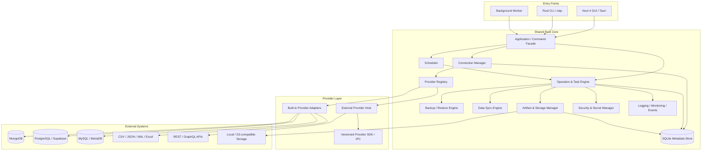
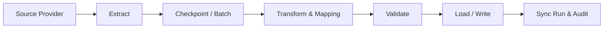

# Universal Data Management Tool
## Roadmap kiến trúc & triển khai — Hybrid Plugin Architecture

> **Mục tiêu tài liệu:** Đây là tài liệu định hướng tổng thể và đặc tả triển khai cho AI Coding Agent. AI phải đọc tài liệu này cùng mã nguồn hiện tại, kiểm tra hiện trạng trước khi thay đổi, sau đó triển khai theo từng giai đoạn có kiểm chứng. Không được hiểu đây là yêu cầu tạo toàn bộ hệ thống trong một lần hoặc xây tất cả provider ngay từ MVP.
>
> **Tên định hướng:** Universal Data Management Tool (UDMT) — công cụ quản lý kết nối, sao lưu, khôi phục, đồng bộ, nhập/xuất và lập lịch cho nhiều loại nguồn dữ liệu.
>
> **Kiến trúc plugin đã chọn:** **Hybrid Plugin Architecture** — provider chính thức được tích hợp trực tiếp trong Rust Core; provider mở rộng của bên thứ ba chạy thành tiến trình riêng, giao tiếp qua giao thức IPC/JSON-RPC có phiên bản.

---

## 0. Quyết định kiến trúc và phạm vi

### 0.1. Tầm nhìn sản phẩm

Xây dựng một ứng dụng desktop-first, có GUI và CLI, dùng chung một bộ xử lý nghiệp vụ để quản lý nhiều nguồn dữ liệu. Sản phẩm không bị khóa vào MongoDB Atlas hoặc Supabase/PostgreSQL. Trong tương lai có thể bổ sung database engine, dịch vụ cloud, object storage, API và định dạng file mà không phải viết lại các thành phần nền tảng như:

- Connection Manager và xác thực kết nối.
- Job/Operation Engine và Task Manager.
- Scheduler và Background Worker.
- Backup, Restore, Import, Export và Data Sync orchestration.
- Artifact Catalog, Storage Manager, Retention và Verification.
- Logging, Monitoring, Notification, CLI và GUI.

Core chỉ điều phối nghiệp vụ chung. Cách kết nối, khám phá tài nguyên, đọc/ghi, backup/restore và giới hạn đặc thù do từng Provider/Adapter công bố qua capability contract.

### 0.2. Các nguyên tắc không được phá vỡ

1. **Provider-agnostic Core:** Core không được chứa logic riêng của MongoDB, PostgreSQL, Supabase hoặc provider cụ thể.
2. **Capability-based:** Không giả định tất cả provider đều hỗ trợ backup, restore, schema, transaction, incremental export hoặc CDC.
3. **Contract-first:** Thiết kế DTO, provider contract, operation contract và plugin protocol trước khi mở rộng provider.
4. **Hybrid plugin:** Built-in provider chạy trong tiến trình ứng dụng/worker; external provider chạy ở tiến trình riêng qua IPC.
5. **Process isolation không đồng nghĩa OS sandbox:** Plugin process giảm ảnh hưởng khi crash, nhưng muốn giới hạn filesystem/network/system calls phải áp dụng cơ chế sandbox của hệ điều hành riêng.
6. **One Core, multiple entrypoints:** GUI, CLI và Worker gọi cùng Rust Core; không viết ba bộ logic nghiệp vụ riêng.
7. **Worker độc lập GUI:** Tác vụ lịch và tác vụ dài phải có thể tiếp tục chạy khi đóng cửa sổ GUI.
8. **Durable jobs:** Trạng thái job, lịch chạy, artifact và checkpoint phải được lưu bền vững; không chỉ lưu trong RAM.
9. **Safe by default:** Không tự động xóa/ghi đè dữ liệu đích, không bỏ qua TLS validation, không ghi credential vào log.
10. **Incremental delivery:** Mỗi giai đoạn phải build, test và có tiêu chí nghiệm thu; không dựng UI giả lập để thay cho backend thật.
11. **Backward compatibility:** Migration phải giữ được connections và operation history hiện hữu; không xóa hoặc đổi cấu trúc dữ liệu cũ mà không có migration.
12. **Extensible without overengineering:** Chuẩn bị contract/plugin từ đầu nhưng chỉ triển khai provider và tính năng nằm trong phase hiện tại.

### 0.3. Phạm vi theo nhóm chức năng

| Nhóm | Mục tiêu | Ưu tiên |
|---|---|---|
| Connection Manager | Lưu, phân loại, kiểm tra và quản lý kết nối | MVP |
| Provider Registry | Đăng ký provider, capability và trạng thái hỗ trợ | MVP |
| Backup / Restore | Backup, restore, cross-restore, preflight và kiểm tra artifact | MVP |
| Operation / Task Manager | Theo dõi, hủy, retry, log và phục hồi trạng thái | MVP |
| CLI | Các lệnh quản lý kết nối và backup/restore | MVP |
| GUI | Nuxt 4 SPA quản lý kết nối, tác vụ và artifacts | MVP |
| Background Worker | Chạy tác vụ dài/lịch độc lập GUI | Phase 2 |
| Scheduler / Retention | Lập lịch và quản lý vòng đời backup | Phase 2 |
| Verification / Notifications | Checksum, xác minh backup, cảnh báo | Phase 3 |
| Data Sync Engine | Đồng bộ giữa các nguồn có mapping và transform | Phase 4 |
| External Provider SDK | Plugin provider bên thứ ba qua IPC | Phase 5 |
| CDC / Advanced Replication | Đồng bộ tăng dần/near-real-time khi provider hỗ trợ | Tương lai |

### 0.4. Không nằm trong MVP

- Không triển khai ngay tất cả database/cloud providers trong danh sách tương lai.
- Không cam kết mọi cặp nguồn có thể đồng bộ hai chiều.
- Không coi file copy, database backup, data sync và CDC là cùng một chức năng.
- Không xây dựng distributed scheduler hoặc multi-user server cluster ở MVP; đây là desktop/local-first tool.
- Không tự động restore vào production mà không có xác nhận rõ ràng.
- Không cho external plugin truy cập tùy ý hệ thống chỉ vì plugin đã được cài đặt.

---

## 1. Tech Stack và cách tổ chức ứng dụng

### 1.1. Stack kế thừa từ bản thiết kế ban đầu

| Thành phần | Công nghệ định hướng | Vai trò |
|---|---|---|
| GUI | Nuxt 4, SPA `ssr: false`, Nuxt UI v4, Tailwind CSS | Giao diện desktop qua Tauri WebView |
| Desktop shell | Tauri v2 | Window, menu, dialog, tray, event và system integration |
| Backend/Core | Rust | Provider adapters, orchestration, scheduler, security, storage |
| CLI | Rust + `clap` | Điều khiển hệ thống không cần GUI |
| Local metadata DB | SQLite + `rusqlite` (`bundled`) | Connections, jobs, schedules, artifact catalog và history |
| Async execution | Tokio | Process, I/O, task orchestration và worker runtime |
| Serialization | Serde + serde_json | DTO, config, manifest và IPC payload |
| Secret protection | OS Keychain/credential store + AES-GCM | Bảo vệ credential và connection secret |
| Native DB tools | Sidecar/official CLI tools | Backup/restore với định dạng native khi phù hợp |

Không đổi stack chỉ vì có thể dùng một framework khác. Chỉ đề xuất thay đổi khi audit chứng minh có vấn đề cụ thể về độ ổn định, khả năng đóng gói, hiệu năng hoặc khả năng bảo trì.

### 1.2. Phân lớp kiến trúc



### 1.3. Nguyên tắc phụ thuộc

- `frontend` chỉ gọi command/API facade đã được công bố; không chứa logic nghiệp vụ backup/restore.
- `cli` chỉ parse arguments, xác thực input và gọi use case trong Core.
- `worker` khởi tạo Core ở chế độ headless, đọc lịch/job đã lưu và thực thi.
- `core` không phụ thuộc Nuxt hoặc Tauri UI. Có thể có adapter mỏng để emit event qua Tauri.
- `providers` không được truy cập trực tiếp SQLite để tự sửa job hoặc artifact metadata. Core quản lý transaction và trạng thái.
- `storage` là nơi lưu artifact; không đồng nhất nó với provider nguồn dữ liệu.
- External plugin giao tiếp qua protocol đã version; không chia sẻ Rust internal structs không ổn định.

### 1.4. Một executable hay nhiều executable?

Mục tiêu ban đầu là GUI và CLI có thể dùng chung một executable. Tiếp tục giữ mục tiêu này nếu có thể triển khai ổn định trên Windows/macOS/Linux.

Tuy nhiên:

- Background Worker phải có khả năng chạy headless và độc lập GUI.
- Có thể cung cấp `db-tool.exe` với subcommands `gui`, `cli`, `worker`; hoặc build thêm `db-tool-worker.exe` nếu entrypoint GUI/CLI chung gây lỗi console, signal, lifecycle hoặc packaging.
- Không hy sinh độ tin cậy của CLI chỉ để ép mọi chế độ vào một file.
- Trước khi chốt, tạo proof-of-concept trên Windows: mở GUI, gọi CLI từ CMD/PowerShell, đảm bảo stdout/stderr/exit code đúng; chạy worker không mở cửa sổ; kiểm tra khi GUI đóng.
- Nếu một binary duy nhất khả thi, triển khai; nếu không, phát hành bộ cài thống nhất chứa các binary dùng chung Core.

---

## 2. Khái niệm cần chuẩn hóa

Các khái niệm sau phải được phân biệt rõ trong code, DB, UI và tài liệu.

### 2.1. Provider

Provider là adapter hiểu một loại hệ thống/engine hoặc giao thức dữ liệu, ví dụ `mongodb`, `postgresql`, `mysql`, `redis`, `rest_api`.

### 2.2. Cloud Service / Connection Profile

Một dịch vụ cloud không nhất thiết là một database engine mới. Ví dụ:

- MongoDB Atlas là dịch vụ hosting/profile của MongoDB.
- Supabase Database là dịch vụ PostgreSQL có các thiết lập và metadata bổ sung.
- Neon là dịch vụ PostgreSQL.
- Cloudflare R2 là object storage tương thích S3, không phải database provider.

Do đó, profile Supabase nên dùng `provider_id = postgresql` kèm `service_profile = supabase`, trừ khi có khả năng API đặc thù cần adapter riêng. Tương tự, Atlas dùng provider MongoDB nhưng có profile `mongodb_atlas`.

### 2.3. Connection

Connection là một cấu hình kết nối cụ thể tới endpoint/database/service, có tên, provider, profile, cấu hình không bí mật và tham chiếu credential an toàn.

### 2.4. Resource

Resource là đơn vị có thể khám phá hoặc xử lý bên trong provider: database, schema, table, collection, bucket, index, keyspace, endpoint hoặc file dataset. Resource type tùy provider.

### 2.5. Operation / Job / Schedule / Run

- **Operation:** Một loại hành động, ví dụ `backup`, `restore`, `sync`, `verify`, `health_check`, `cleanup`.
- **Job:** Cấu hình công việc có thể chạy một lần hoặc được Scheduler kích hoạt.
- **Schedule:** Quy tắc thời gian để tạo các lần chạy Job.
- **Run/Execution:** Một lần thực thi cụ thể của Job.
- **Task:** Đơn vị runtime đang chạy, có trạng thái, progress, cancellation và log.

### 2.6. Backup Artifact và Storage Backend

- **Backup Artifact:** Kết quả backup đã hoàn thành, có metadata, manifest, checksum và vị trí lưu.
- **Storage Backend:** Nơi chứa artifact, ví dụ local filesystem, S3, Cloudflare R2, MinIO.
- **Archive Format:** Định dạng đóng gói/backup, ví dụ MongoDB dump directory/archive, PostgreSQL custom dump, SQL, JSON/CSV. Không đồng nhất archive format với storage backend.

### 2.7. Backup/Restore so với Data Sync

| Chức năng | Mục đích | Kết quả |
|---|---|---|
| Backup | Tạo bản lưu có thể phục hồi | Backup artifact |
| Restore | Khôi phục artifact vào target | Dữ liệu được ghi lên target |
| Export/Import | Chuyển dữ liệu theo format/provider | File hoặc dữ liệu đích |
| Data Sync | Trích xuất, mapping/transform và nạp sang target | Dataset đồng bộ |
| Replication/CDC | Theo dõi thay đổi và chuyển tiếp liên tục/tăng dần | Dòng thay đổi hoặc bản sao cập nhật |

Không dùng thuật ngữ “backup” cho một lần copy dữ liệu thông thường nếu không có metadata/khả năng khôi phục được xác định.

---

## 3. Provider System — Hybrid Plugin Architecture

### 3.1. Hai loại provider

**A. Built-in Providers**

- Nằm trong Rust workspace/repository chính.
- Có thể gọi trực tiếp Core interfaces, nhưng không được phụ thuộc ngược vào UI.
- Được compile và release cùng ứng dụng.
- Dùng cho các provider chính thức cần độ tin cậy, hiệu năng và trải nghiệm tích hợp tốt.

**B. External Providers**

- Được đóng gói thành process executable riêng.
- Chạy dưới Provider Host do ứng dụng quản lý.
- Trao đổi request/response/event bằng JSON-RPC hoặc protocol IPC phiên bản hóa.
- Có manifest, version, capabilities, permissions và compatibility range.
- Có thể cài, disable, update, remove độc lập.
- Không được tự động tin cậy chỉ vì file plugin xuất hiện trong thư mục.

Không dùng Rust dynamic library (`.dll`/`.so`/`.dylib`) làm cơ chế plugin mặc định. Dynamic library dễ gây rủi ro ABI/version/crash trong tiến trình chính. Process plugin dễ quản lý lifecycle và failure boundary hơn.

### 3.2. Capability contract

Provider phải khai báo capability thực tế. Gợi ý capability registry:

| Capability | Ý nghĩa |
|---|---|
| `test_connection` | Kiểm tra kết nối và xác thực |
| `discover_resources` | Liệt kê database/schema/table/collection/bucket… |
| `read_data` | Đọc/trích xuất dữ liệu |
| `write_data` | Ghi/nạp dữ liệu |
| `native_backup` | Backup bằng native mechanism/tool |
| `native_restore` | Restore bằng native mechanism/tool |
| `schema_read` | Đọc metadata/schema |
| `schema_write` | Tạo/thay đổi schema nếu provider hỗ trợ |
| `transactions` | Hỗ trợ transaction trong phạm vi được công bố |
| `bulk_write` | Ghi theo lô |
| `consistent_snapshot` | Tạo snapshot nhất quán theo cơ chế provider |
| `incremental_export` | Export phần thay đổi kể từ checkpoint |
| `change_stream` | Theo dõi thay đổi/CDC |
| `query` | Chạy truy vấn có giới hạn/được cấp quyền |
| `object_read` / `object_write` | Đọc/ghi object/file |

Quy tắc:

- Không suy luận capability từ tên provider.
- Mỗi capability có thể có `constraints`, `minimum_version`, `supported_resource_types` và giới hạn.
- UI chỉ hiển thị action tương ứng capability đã xác nhận.
- Nếu capability không hỗ trợ, trả về lỗi có mã rõ ràng như `CAPABILITY_UNSUPPORTED`, không giả lập thành công.
- Capability có thể thay đổi theo version server, quyền tài khoản, edition hoặc cấu hình connection; cần phân biệt `declared_capabilities` và `detected_capabilities`.

### 3.3. Contract Rust ở mức khái niệm

Đây là định hướng interface, không phải yêu cầu copy nguyên mẫu vào production. AI phải thiết kế DTO thống nhất, async runtime nhất quán, cancellation và error model trước khi triển khai.

```rust
#[derive(Clone, Debug, serde::Serialize, serde::Deserialize)]
pub struct ProviderDescriptor {
    pub provider_id: String,
    pub display_name: String,
    pub version: String,
    pub capabilities: Vec<CapabilityDescriptor>,
}

#[async_trait::async_trait]
pub trait DataProvider: Send + Sync {
    fn descriptor(&self) -> ProviderDescriptor;

    async fn validate_config(
        &self,
        config: ProviderConfig,
    ) -> Result<ValidatedProviderConfig, ProviderError>;

    async fn test_connection(
        &self,
        connection: ProviderConnection,
        ctx: OperationContext,
    ) -> Result<ConnectionTestResult, ProviderError>;

    async fn discover_resources(
        &self,
        connection: ProviderConnection,
        request: DiscoverRequest,
        ctx: OperationContext,
    ) -> Result<Vec<ResourceDescriptor>, ProviderError>;
}
```

Các operation có thể được tách thành trait/interface capability riêng (ví dụ `BackupProvider`, `RestoreProvider`, `DataReader`, `DataWriter`, `SchemaProvider`) hoặc một operation dispatcher typed. Không tạo một trait khổng lồ bắt mọi provider phải implement mọi phương thức.

Yêu cầu kỹ thuật:

- Dùng một async runtime thống nhất; tránh tạo runtime lồng nhau không cần thiết.
- Mọi operation dài phải nhận `OperationContext` gồm `run_id`, cancellation token, deadline/timeout, event sender, progress reporter và credential provider scoped.
- Error phải là typed error có `code`, `message` an toàn, `retryable`, `details` đã lọc bí mật.
- Không serialize credential vào `Debug`, tracing span hoặc error payload.
- Có contract test dùng chung cho tất cả provider.

### 3.4. External Plugin manifest

Ví dụ cấu trúc manifest định hướng:

```json
{
  "manifest_version": "1",
  "plugin_id": "com.example.redis-provider",
  "display_name": "Redis Provider",
  "plugin_version": "1.0.0",
  "provider_id": "redis",
  "provider_api": {
    "min": "1.0",
    "max": "1.x"
  },
  "entrypoint": {
    "windows-x86_64": "bin/redis-provider.exe",
    "linux-x86_64": "bin/redis-provider",
    "macos-aarch64": "bin/redis-provider"
  },
  "capabilities": [
    "test_connection",
    "discover_resources",
    "read_data",
    "write_data"
  ],
  "permissions": [
    "network:configured-endpoints",
    "filesystem:task-temp"
  ]
}
```

Manifest thực tế cần bổ sung publisher, homepage/support, license, checksums/signature, minimum application version, platform/architecture, dependency requirements và schema cấu hình. Không cho plugin tự khai báo quyền rộng hơn policy của ứng dụng rồi tự cấp quyền.

### 3.5. External Plugin Protocol

- Protocol có version độc lập với version ứng dụng.
- JSON-RPC 2.0 qua stdin/stdout hoặc IPC local; stdout chỉ dành cho protocol, log chẩn đoán gửi stderr.
- Với dữ liệu lớn, không nhét toàn bộ binary payload vào JSON message; sử dụng stream/pipe hoặc file tạm có quyền truy cập giới hạn và lifecycle rõ ràng.
- Mỗi request có `request_id`, `run_id`, timeout và cancellation semantics.
- Có handshake (`initialize`/`hello`) để trao đổi plugin version, protocol compatibility và capabilities thực tế.
- Host giới hạn message size, thời gian phản hồi, số process, memory/CPU khi có thể, số request đồng thời và tốc độ log.
- Host phải xử lý plugin crash, hang, malformed response, protocol mismatch và shutdown không sạch.
- Không cho plugin tự quyết định đường dẫn tùy ý để đọc/ghi file; truyền scoped paths/tokens theo quyền đã cấp.
- Không chuyển credential qua command-line arguments. Ưu tiên credential broker/IPC secure channel hoặc input stream có bảo vệ; mọi giải pháp fallback phải được đánh giá theo platform và không log nội dung.

**Lưu ý bảo mật:** Chạy plugin ở process riêng không tự động giới hạn quyền truy cập mạng, filesystem hoặc tài khoản người dùng. Nếu cần sandbox thật, nghiên cứu và áp dụng cơ chế OS tương ứng; nếu chưa có, UI phải nói rõ plugin đang chạy với quyền của user/process hiện tại.

### 3.6. Plugin lifecycle và trust

1. Discover plugin package từ thư mục được quản lý.
2. Đọc manifest và validate schema.
3. Kiểm tra platform, version tương thích, checksum/chữ ký nếu có.
4. Hiển thị publisher, permission, version và cảnh báo plugin chưa xác minh.
5. User chủ động enable và cấp quyền.
6. Khởi động process, handshake và health check.
7. Theo dõi trạng thái, restart policy có giới hạn và crash count.
8. Disable/uninstall phải dừng process, giải phóng handle và không tự xóa dữ liệu người dùng nếu chưa xác nhận.

Không cho phép cài plugin âm thầm hoặc tự động chạy plugin mới tải về.

### 3.7. Provider registry và discovery

Registry quản lý:

- Built-in provider descriptors.
- External plugin descriptors.
- Trạng thái: available, disabled, incompatible, unhealthy, missing dependency, untrusted.
- Provider API version và plugin version.
- Capability declarations và detected capability state.
- Diagnostics/last health check.

Provider Registry không lưu credential; Connection Manager chịu trách nhiệm quản lý secret reference.

---

## 4. Danh mục nguồn dữ liệu và thứ tự mở rộng

Đây là danh sách định hướng. Không triển khai toàn bộ trong một release.

### 4.1. Database providers

| Provider ID | Engine/nguồn | Profile/dịch vụ có thể gắn kèm | Ưu tiên đề xuất |
|---|---|---|---|
| `mongodb` | MongoDB | MongoDB Atlas, self-hosted, local | V1 |
| `postgresql` | PostgreSQL | Supabase, Neon, self-hosted, cloud PostgreSQL | V1 |
| `mysql` | MySQL | Managed MySQL, self-hosted | V1.x |
| `mariadb` | MariaDB | Managed/self-hosted | V1.x |
| `sqlite` | SQLite file | Local file | V1.x |
| `redis` | Redis | Managed Redis, self-hosted | V2.x |
| `sqlserver` | Microsoft SQL Server | Managed/self-hosted | Later |
| `oracle` | Oracle Database | Managed/self-hosted | Later |
| `elasticsearch` | Elasticsearch/OpenSearch | Managed/self-hosted | Later |

### 4.2. Cloud/service profiles

Cloud service nên là profile/configuration trên engine tương ứng khi giao thức và operation giống nhau. Chỉ tạo adapter riêng khi service có API, authentication hoặc operation đặc thù.

Ví dụ: `mongodb_atlas`, `supabase`, `neon`, `planetscale` là service profiles/tích hợp, không nhất thiết là engine provider riêng.

### 4.3. Object storage providers

- Local filesystem (MVP storage backend).
- S3-compatible storage.
- Cloudflare R2.
- MinIO.
- Backblaze B2.

Object storage là nơi lưu backup artifacts hoặc input/output data; không mặc nhiên là nguồn database.

### 4.4. File và API connectors

- CSV, JSON, JSONL, XML, Excel/XLSX.
- REST API.
- GraphQL.
- Có thể thêm Parquet và các format phân tích dữ liệu sau.

File formats nên được xử lý bởi format adapters; REST/GraphQL là source/sink connectors. Không nhồi mọi format vào database provider interface.

### 4.5. Mục tiêu provider theo release

- **V1.0:** MongoDB và PostgreSQL; Supabase qua PostgreSQL service profile.
- **V1.x:** MySQL/MariaDB/SQLite tùy độ ổn định và nhu cầu.
- **V2.x:** Redis, object storage cloud và file connectors.
- **V2.x+ :** REST/GraphQL, Elasticsearch/OpenSearch, SQL Server/Oracle theo nhu cầu.
- **V3 hoặc sau:** External provider ecosystem hoàn chỉnh, CDC và advanced replication.

Thứ tự có thể thay đổi sau khi audit, nhưng không thay đổi nguyên tắc Core/contract.

---

## 5. Connection Manager và Secret Management

### 5.1. Connection model

Mỗi connection cần tối thiểu:

- `id` ổn định.
- `name` duy nhất trong phạm vi ứng dụng.
- `provider_id` (engine/provider).
- `service_profile` tùy chọn.
- `provider_api_version`/`provider_version` nếu cần tương thích.
- `config_json` chỉ chứa cấu hình không bí mật.
- `credential_ref` tham chiếu secret trong OS credential store.
- `environment`: local, development, staging, production hoặc custom.
- `tags`, `description`, `default_storage_id`, `created_at`, `updated_at`.
- `last_tested_at`, `last_test_status` và thông tin chẩn đoán đã lọc.

Không lưu nguyên connection URI có password/token dạng plaintext trong SQLite. Có thể hỗ trợ import URI nhưng phải parse, tách secret và lưu đúng nơi.

### 5.2. Secret policy

- Ưu tiên Windows Credential Manager/DPAPI-backed store, macOS Keychain và Linux Secret Service/keyring.
- Có thể dùng AES-GCM để mã hóa secret ở tầng ứng dụng, nhưng khóa giải mã phải được bảo vệ bằng OS keyring hoặc một cơ chế key management phù hợp.
- Không hardcode master key, không lưu master key cạnh file SQLite, không dùng một key tĩnh chung cho mọi user.
- Không fallback âm thầm sang plaintext khi keyring không khả dụng. Báo rõ và yêu cầu người dùng chọn phương án an toàn được hỗ trợ.
- Credential chỉ được giải mã trong phạm vi cần thiết và thời gian ngắn.
- Redact URI, password, API key, bearer token, private key, connection query parameter nhạy cảm khỏi log/error/CLI verbose.
- Khi export connection profile, mặc định không export secret. Có flow riêng để export encrypted bundle nếu sản phẩm hỗ trợ trong tương lai.

### 5.3. Connection test

`test_connection` cần trả về:

- `success`.
- Provider/service identity đã nhận diện.
- Server version nếu có.
- Latency/elapsed time.
- Authentication/permission diagnostic đã sanitize.
- Discovered capabilities nếu có thể xác minh.
- Thời gian test và thời điểm hết hạn của kết quả capability detection.

Không chỉ kiểm tra socket/TCP rồi hiển thị “Connected” khi authentication/database permission chưa được kiểm tra.

---

## 6. Backup Engine

### 6.1. Mục tiêu

Backup Engine nhận yêu cầu tổng quát, kiểm tra capability của source, lựa chọn chiến lược backup phù hợp và tạo artifact có manifest.

### 6.2. Chiến lược backup

Thứ tự ưu tiên:

1. Native backup tool/API khi provider có công cụ chính thức và phù hợp.
2. Provider snapshot/export API nếu hỗ trợ.
3. Logical export qua provider adapter.
4. Không hiển thị backup capability nếu không có phương thức đáng tin cậy.

Không cố áp dụng một câu lệnh/format chung cho mọi provider.

### 6.3. MVP native tooling

**MongoDB**

- Dùng MongoDB Database Tools (`mongodump`, `mongorestore`) làm sidecar khi phù hợp.
- Hỗ trợ lựa chọn database/collection, gzip/archive options nếu tool version hỗ trợ.
- Hỗ trợ restore namespace mapping khi phù hợp.
- Ghi nhận phiên bản tool và các option đã dùng vào metadata.

**PostgreSQL / Supabase**

- Dùng `pg_dump` và `pg_restore`; `psql` cho SQL dump khi cần.
- Custom format (`-Fc`) là lựa chọn mặc định hợp lý cho backup logical cần restore linh hoạt.
- Hỗ trợ `--no-owner`/`--no-acl` theo profile/đích phù hợp; không mặc định áp mọi flags cho mọi môi trường mà không kiểm tra.
- Ghi nhận phiên bản PostgreSQL tools, server version, selected schemas/tables và restore compatibility notes.

Tài liệu gốc có ví dụ câu lệnh native tool để tham khảo; triển khai thực tế phải validate version/flags theo tool được đóng gói và không ghép chuỗi shell từ input người dùng.

### 6.4. Backup preflight

Trước khi chạy:

- Kiểm tra connection, quyền cần thiết, provider capability.
- Kiểm tra thư mục đích còn dung lượng đủ ở mức ước lượng nếu có thể.
- Kiểm tra sidecar executable tồn tại, đúng platform/architecture và đúng version.
- Kiểm tra đường dẫn output, quyền ghi, tên artifact và collision.
- Kiểm tra task trùng lặp/lock.
- Ước lượng và hiển thị các giới hạn nhất quán dữ liệu (snapshot consistency) mà provider công bố.
- Với scheduled backup, kiểm tra lịch và policy trước khi tạo run.

### 6.5. Artifact manifest

Mỗi artifact cần manifest machine-readable, ví dụ:

```json
{
  "manifest_version": "1",
  "artifact_id": "uuid",
  "operation_type": "backup",
  "provider_id": "postgresql",
  "service_profile": "supabase",
  "source_connection_id": "connection-id",
  "source_label": "staging-db",
  "created_at": "ISO-8601 timestamp",
  "tool_name": "pg_dump",
  "tool_version": "captured-version",
  "backup_format": "postgres-custom",
  "compression": "native-or-configured",
  "resources": [],
  "files": [],
  "checksums": [],
  "status": "completed"
}
```

Manifest không được chứa credential, raw connection URI hoặc dữ liệu nhạy cảm. Resource names có thể nhạy cảm; cung cấp tùy chọn ẩn/redact khi export manifest.

### 6.6. Tính toàn vẹn và xác minh

- Tính checksum mạnh (ví dụ SHA-256) sau khi artifact hoàn tất.
- Kiểm tra kích thước, file list, manifest và checksum khi verify.
- Với archive/native backup, chạy integrity/list operation nếu công cụ hỗ trợ.
- Phân biệt `file_integrity_verified` với `restore_tested`; checksum đúng không chứng minh artifact chắc chắn restore được.
- Restore test vào môi trường tạm/disposable là mức xác minh cao hơn, nhưng phải có sự cho phép và tài nguyên riêng.

### 6.7. Backup status

Gợi ý trạng thái: `queued`, `preparing`, `running`, `finalizing`, `verifying`, `completed`, `completed_with_warnings`, `failed`, `cancel_requested`, `cancelled`, `interrupted`.

Không đánh dấu `completed` trước khi output đóng file, flush, manifest và checksum được ghi thành công.

---

## 7. Restore Engine và Safe Restore

### 7.1. Restore source/target độc lập

Restore request phải tách:

- Artifact/input source.
- Target connection.
- Target resource mapping.
- Restore options.
- Safety policy.

Cho phép cross-restore từ connection A sang connection B, ví dụ production backup sang staging/local để kiểm thử. Không gắn cứng restore artifact vào connection ban đầu.

### 7.2. Restore preflight

Trước khi thực thi:

- Validate artifact/manifest/checksum.
- Xác định provider và format tương thích.
- Test target connection và quyền cần thiết.
- Kiểm tra version compatibility (source/target/tool).
- Xác định xung đột tên resource, schema, collection, database hoặc object.
- Hiển thị chính xác hành động có thể xóa/ghi đè.
- Ước lượng tác động và các bước rollback khả thi nếu provider hỗ trợ.
- Không giả định tất cả restore có thể rollback nguyên tử.

### 7.3. Safety policy

- Mặc định không bật destructive flags (`drop`, `clean`, overwrite).
- Có `dry_run`/preview nếu provider/tool hỗ trợ; không giả lập dry-run nếu underlying tool không thực sự có khả năng đó.
- Nếu target được đánh dấu `production`, yêu cầu xác nhận bổ sung: gõ lại tên connection hoặc cụm xác nhận rõ ràng.
- Với thao tác xóa/ghi đè, phải hiển thị target connection + resource cụ thể và yêu cầu người dùng xác nhận riêng.
- Cho phép giới hạn restore theo database/schema/table/collection nếu provider hỗ trợ.
- Ghi lại user-intent/confirmation metadata trong operation audit, không ghi secret.

### 7.4. Restore options

Các option phải được provider-specific schema mô tả. UI sinh option từ schema/capability, không áp một danh sách flags chung cho tất cả provider.

Ví dụ MongoDB: gzip/archive, drop, namespace mapping, selected namespaces.

Ví dụ PostgreSQL: clean/if-exists, no-owner/no-acl, schema/table selection, jobs/parallelism nếu hỗ trợ.

### 7.5. Restore status và recovery

Trạng thái gồm `preflight`, `queued`, `running`, `finalizing`, `completed`, `completed_with_warnings`, `failed`, `cancel_requested`, `cancelled`, `interrupted`.

Nếu app/worker bị dừng giữa lúc restore:

- Lưu được thông tin run và trạng thái cuối đã xác nhận.
- Không tự động resume thao tác có thể ghi dữ liệu dở dang nếu provider không hỗ trợ resume an toàn.
- Đánh dấu `interrupted` và yêu cầu kiểm tra target trước khi chạy lại.
- Hiển thị cảnh báo dữ liệu đích có thể ở trạng thái một phần.

---

## 8. Data Sync Engine — thiết kế riêng, không nhập nhằng với Backup

### 8.1. Mục tiêu

Data Sync Engine cho phép chuyển dữ liệu từ Source sang Destination thông qua một pipeline có thể cấu hình:



### 8.2. Các bước pipeline

1. Chọn source connection và resource.
2. Chọn destination connection và target resource.
3. Khám phá source schema/fields.
4. Mapping field/schema và datatype.
5. Cấu hình filter/query/selection trong phạm vi capability.
6. Cấu hình transform (rename, cast, default, date/time mapping, value mapping, mask/redact nếu phù hợp).
7. Validate sample/batch trước khi chạy toàn bộ.
8. Chọn load mode.
9. Execute theo batch, lưu checkpoint và progress.
10. Kiểm tra kết quả, số lượng đọc/ghi/bỏ qua/lỗi và báo cáo sai khác.

### 8.3. Load modes

- `append`: thêm dữ liệu.
- `upsert`: insert/update theo key khi cả source/target hỗ trợ semantics phù hợp.
- `replace_resource`: thay thế resource đã chọn; luôn cần preflight/xác nhận.
- `truncate_and_load`: chỉ bật khi provider hỗ trợ và người dùng xác nhận destructive action.
- `merge`: chỉ dùng khi có quy tắc conflict rõ ràng; không mặc định hỗ trợ mọi provider.

### 8.4. Type mapping

- Có registry mapping source type → canonical/intermediate type → target type.
- Bảo toàn giá trị gốc khi có thể; cảnh báo khi target type không tương đương.
- Có quy tắc cho numeric precision, timezone, nullability, binary, nested JSON/BSON, arrays và large objects.
- Report số field/value được chuyển đổi, bị mất độ chính xác hoặc không hỗ trợ.
- Không tuyên bố round-trip fidelity tuyệt đối giữa hai engine khác nhau.

### 8.5. Reliability và hiệu năng

- Streaming/batch processing, không load toàn bộ dataset vào RAM.
- Configurable batch size và concurrency trong giới hạn provider.
- Checkpoint theo resource/partition/offset khi có thể.
- Retry chỉ cho lỗi transient/idempotent; không retry mù các lệnh ghi không idempotent.
- Cơ chế deduplication/idempotency key nếu provider hỗ trợ.
- Backpressure và cancellation xuyên suốt pipeline.
- Lưu thống kê và lỗi theo batch; giới hạn log/sample data để tránh lưu dữ liệu nhạy cảm.

### 8.6. Phân biệt mức sync

- **Full sync:** đọc toàn bộ phạm vi đã chọn và ghi lại theo load mode.
- **Incremental sync:** chỉ lấy phần thay đổi; cần checkpoint hoặc watermark đáng tin cậy.
- **CDC/Replication:** nhận change events liên tục; yêu cầu provider có change stream/logical replication/binlog/API tương ứng.

MVP chỉ cần thiết kế contract và có thể triển khai pipeline cơ bản ở phase riêng. Không hứa hẹn incremental/CDC cho provider không hỗ trợ.

---

## 9. Storage Manager và Artifact Lifecycle

### 9.1. Storage backend abstraction

Tách storage backend khỏi source provider:

```text
Artifact producer (backup/export)
        ↓
Artifact writer
        ↓
Storage backend interface
        ├── Local filesystem (MVP)
        ├── S3-compatible (future)
        ├── Cloudflare R2 (future)
        └── MinIO / other object storage (future)
```

Storage backend contract tối thiểu: validate config, test connection, put/write stream, get/read stream, list, stat, delete, move/copy nếu backend hỗ trợ. Không giả định mọi backend hỗ trợ atomic rename hoặc versioning.

### 9.2. Artifact catalog

Mỗi artifact có:

- Artifact ID và operation/run ID.
- Provider/source label đã sanitize.
- Backup format, resource scope và created_at.
- Storage backend + storage object key/path.
- Size, checksum, compression/encryption state.
- Manifest version, tool/provider version.
- Verification status và restore-test status.
- Retention/expiry state.
- Parent/base artifact nếu sau này có incremental chain.

### 9.3. Retention policy

Hỗ trợ định hướng:

- Giữ N bản backup gần nhất.
- Retain theo hourly/daily/weekly/monthly/yearly.
- Giữ bản cuối mỗi ngày/tuần/tháng/năm.
- Retain theo số ngày hoặc tổng dung lượng.
- Loại trừ artifact được pin/đánh dấu protected.

Không xóa artifact trước khi kiểm tra:

- Artifact không đang được restore/verify.
- Artifact không phải base dependency của incremental chain còn cần.
- Policy áp dụng đúng connection/job/provider.
- Có audit event.

### 9.4. Storage safety

- Không xóa file ngoài root/path mà ứng dụng quản lý nếu không có lựa chọn/ủy quyền rõ ràng.
- Chống path traversal, symlink abuse và tên file độc hại.
- Dùng temp file/temporary object và finalize/rename khi backend hỗ trợ.
- Khi backup thất bại, đánh dấu partial artifact và cleanup theo policy an toàn; không giả là artifact hoàn chỉnh.

---

## 10. Scheduler và Background Worker

### 10.1. Mục tiêu

Scheduler tạo lịch chạy cho nhiều loại operation, không chỉ backup. Worker thực thi job độc lập với GUI.

Các operation có thể lập lịch khi provider hỗ trợ:

- Backup.
- Sync.
- Health check.
- Artifact verification.
- Restore test vào môi trường disposable (chỉ khi được cấu hình rõ).
- Retention cleanup.
- Các tác vụ bảo trì khác trong tương lai.

### 10.2. Schedule types

- One-time.
- Every N minutes/hours.
- Daily.
- Weekly.
- Monthly.
- Yearly.
- Custom cron (nếu hỗ trợ, cần validate và giải thích timezone).

Mỗi schedule cần timezone IANA, thời điểm bắt đầu/kết thúc, enabled/disabled, misfire policy, overlap policy và next-run calculation.

### 10.3. Scheduler reliability

Phải xử lý:

- Missed run khi máy tắt hoặc Worker offline.
- DST/timezone chuyển đổi.
- Job chạy quá thời gian đến lượt tiếp theo.
- Không chạy trùng cùng một schedule nếu overlap policy là forbid.
- Restart/crash/reboot.
- Clock drift và invalid cron.
- Retry/backoff/jitter cho lỗi transient.
- Concurrency limit toàn hệ thống và theo provider/connection.
- Distributed locking chưa nằm trong MVP; local lock phải chống double execution giữa hai worker cùng profile.

Misfire policies gợi ý: `skip`, `run_once_on_recovery`, `run_all_missed` (chỉ áp dụng khi người dùng hiểu rõ nguy cơ). Default cho backup định kỳ: `run_once_on_recovery`, tránh chạy dồn hàng loạt.

### 10.4. Worker lifecycle

Worker cần hỗ trợ:

- `start`, `stop`, `restart`, `status`, `health`, `version`.
- Graceful shutdown: ngừng nhận job mới, phát cancellation theo policy, flush log/state, đóng connection.
- Heartbeat định kỳ và worker instance ID.
- Process exit code có ý nghĩa.
- Crash recovery: rà soát task đang `running` nhưng worker đã mất; đánh dấu `interrupted` hoặc recovery state.
- Watchdog/restart policy có giới hạn, tránh restart loop.

GUI phải hiển thị các trạng thái: `Stopped`, `Starting`, `Running`, `Stopping`, `Unhealthy`, `Crashed`, `Updating`.

**Không đánh dấu Worker Running chỉ vì process đã spawn.** Phải chờ handshake/heartbeat/health check xác nhận engine đã sẵn sàng. Khi dừng, UI tiếp tục hiển thị `Stopping` đến khi Worker xác nhận shutdown hoặc process exit đã được kiểm tra.

### 10.5. OS integration

- Windows: tích hợp Windows Task Scheduler hoặc Startup/Service mode phù hợp cho Worker; có hướng dẫn cài/gỡ và quyền cần thiết.
- macOS: LaunchAgent là hướng mở rộng.
- Linux: systemd user service là hướng mở rộng.
- MVP có thể ưu tiên Windows, nhưng service manager interface không hardcode Windows vào Scheduler/Core.

Tauri GUI có thể đóng cửa sổ nhưng Worker vẫn tiếp tục chạy. Có lựa chọn tray/minimize-to-tray nếu khả thi; phải có trạng thái hiển thị rõ ràng khi app đóng nhưng Worker còn hoạt động.

### 10.6. Task Manager UI

Màn hình Operations/Tasks phải có:

- Running, queued, scheduled, completed, failed, interrupted.
- Operation type/provider/connection/resource.
- Progress %, stage, elapsed time, throughput/rows/bytes nếu có.
- Live logs theo run ID.
- Cancel, retry, open artifact, inspect error.
- Không cho retry mù với operation destructive/không idempotent.
- Phân biệt task process, worker health và provider connection health.

---

## 11. Local SQLite Metadata Database

### 11.1. Quy tắc

- Dùng SQLite làm metadata store local, không lưu toàn bộ backup/dataset vào SQLite.
- Mọi thay đổi schema qua versioned migrations.
- Bật foreign keys, thiết lập busy timeout và journal mode phù hợp.
- Không chạy truy vấn SQLite blocking nặng trên Tokio async executor; dùng `spawn_blocking`, DB actor/thread hoặc chiến lược repository phù hợp.
- Thiết kế một nơi chịu trách nhiệm transaction để GUI/CLI/Worker không tự ghi trạng thái cạnh tranh.
- Đảm bảo backup metadata DB của chính ứng dụng có thể thực hiện an toàn.

### 11.2. Schema đề xuất

Đây là logical schema. AI phải tinh chỉnh kiểu dữ liệu/index/foreign keys sau khi audit, không nhất thiết tạo mọi bảng trong MVP.

#### Core tables

**`connections`**

- `id TEXT PRIMARY KEY`
- `name TEXT NOT NULL UNIQUE`
- `provider_id TEXT NOT NULL`
- `service_profile TEXT NULL`
- `config_json TEXT NOT NULL`
- `credential_ref TEXT NULL`
- `environment TEXT NULL`
- `description TEXT NULL`
- `default_storage_id TEXT NULL`
- `is_active INTEGER NOT NULL DEFAULT 1`
- `created_at TEXT NOT NULL`
- `updated_at TEXT NOT NULL`
- `last_tested_at TEXT NULL`
- `last_test_status TEXT NULL`

**`provider_installations`**

- `id TEXT PRIMARY KEY`
- `plugin_id TEXT NOT NULL UNIQUE`
- `provider_id TEXT NOT NULL`
- `plugin_version TEXT NOT NULL`
- `manifest_json TEXT NOT NULL`
- `install_path TEXT NOT NULL`
- `trust_status TEXT NOT NULL`
- `enabled INTEGER NOT NULL DEFAULT 0`
- `health_status TEXT NULL`
- `installed_at TEXT NOT NULL`

**`storage_backends`**

- `id TEXT PRIMARY KEY`
- `name TEXT NOT NULL UNIQUE`
- `backend_type TEXT NOT NULL`
- `config_json TEXT NOT NULL`
- `credential_ref TEXT NULL`
- `is_default INTEGER NOT NULL DEFAULT 0`
- `created_at TEXT NOT NULL`
- `updated_at TEXT NOT NULL`

**`jobs`**

- `id TEXT PRIMARY KEY`
- `name TEXT NOT NULL`
- `operation_type TEXT NOT NULL`
- `source_connection_id TEXT NULL`
- `target_connection_id TEXT NULL`
- `storage_backend_id TEXT NULL`
- `operation_config_json TEXT NOT NULL`
- `enabled INTEGER NOT NULL DEFAULT 1`
- `created_at TEXT NOT NULL`
- `updated_at TEXT NOT NULL`

**`job_schedules`**

- `id TEXT PRIMARY KEY`
- `job_id TEXT NOT NULL`
- `schedule_type TEXT NOT NULL`
- `schedule_config_json TEXT NOT NULL`
- `timezone TEXT NOT NULL`
- `misfire_policy TEXT NOT NULL`
- `overlap_policy TEXT NOT NULL`
- `next_run_at TEXT NULL`
- `last_run_at TEXT NULL`
- `enabled INTEGER NOT NULL DEFAULT 1`

**`operation_runs`**

- `id TEXT PRIMARY KEY`
- `job_id TEXT NULL`
- `operation_type TEXT NOT NULL`
- `status TEXT NOT NULL`
- `source_connection_id TEXT NULL`
- `target_connection_id TEXT NULL`
- `started_at TEXT NULL`
- `finished_at TEXT NULL`
- `progress_json TEXT NULL`
- `result_json TEXT NULL`
- `error_code TEXT NULL`
- `error_message_safe TEXT NULL`
- `worker_instance_id TEXT NULL`
- `created_at TEXT NOT NULL`

**`operation_logs`**

- `id INTEGER PRIMARY KEY AUTOINCREMENT`
- `run_id TEXT NOT NULL`
- `sequence INTEGER NOT NULL`
- `level TEXT NOT NULL`
- `stage TEXT NULL`
- `message TEXT NOT NULL`
- `created_at TEXT NOT NULL`

Không nhất thiết lưu mọi dòng log dài hạn trong SQLite. Có thể dùng structured log files và lưu index/summary trong SQLite để tránh DB phình lớn.

**`artifacts`**

- `id TEXT PRIMARY KEY`
- `run_id TEXT NOT NULL`
- `artifact_type TEXT NOT NULL`
- `provider_id TEXT NULL`
- `storage_backend_id TEXT NOT NULL`
- `object_key TEXT NOT NULL`
- `manifest_json TEXT NOT NULL`
- `size_bytes INTEGER NULL`
- `checksum_algorithm TEXT NULL`
- `checksum_value TEXT NULL`
- `verification_status TEXT NOT NULL`
- `restore_test_status TEXT NULL`
- `created_at TEXT NOT NULL`
- `expires_at TEXT NULL`
- `pinned INTEGER NOT NULL DEFAULT 0`

#### Extensible tables theo phase

- `retention_policies`
- `sync_pipelines`
- `sync_runs` (hoặc dùng operation_runs với bảng detail riêng)
- `task_locks`
- `worker_instances`
- `notification_channels`
- `notification_events`
- `schema_migrations`

Không tạo bảng chỉ để “có kiến trúc” nếu phase chưa có use case. Ưu tiên quan hệ rõ, migration đơn giản và query có index.

### 11.3. Migration từ schema cũ

Schema ban đầu đã có `connections` với `provider`, `uri_encrypted`, `default_dir`, `created_at` và `operation_logs` với `conn_id`, `action_type`, `target_path`, `status`, `executed_at`.

AI phải:

1. Kiểm tra schema thật đang tồn tại trong repository/local DB.
2. Tạo migration có version, transaction và backup metadata DB trước migration quan trọng.
3. Map `provider` cũ sang `provider_id` + `service_profile`.
4. Giữ `uri_encrypted` tương thích trong giai đoạn chuyển đổi; chỉ xóa sau khi xác nhận secret đã migrate thành công.
5. Map `operation_logs` cũ sang run/history mới; không làm mất history.
6. Migration phải idempotent theo versioning, có test upgrade từ DB cũ và rollback strategy khi khả thi.
7. Không reset DB người dùng để đổi schema.

---

## 12. Operation Engine, Concurrency và Recovery

### 12.1. Unified operation lifecycle

Mọi operation đi qua cùng một lifecycle:

```text
Request
  → Validate Input
  → Resolve Provider/Connection/Storage
  → Capability Check
  → Preflight
  → Acquire Locks
  → Create Durable Run
  → Execute
  → Stream Progress/Logs
  → Finalize Artifacts/Results
  → Persist Final State
  → Release Locks
  → Notify UI/CLI
```

### 12.2. Task states

State machine phải được định nghĩa bằng enum và transition rules, không để frontend tự suy đoán.

Các state đề xuất:

- `queued`
- `preparing`
- `preflight`
- `running`
- `finalizing`
- `verifying`
- `completed`
- `completed_with_warnings`
- `failed`
- `cancel_requested`
- `cancelled`
- `interrupted`
- `retry_waiting`

Chỉ cho transition hợp lệ. Không cho `completed` quay lại `running`; retry tạo run mới và giữ liên kết `retry_of_run_id`.

### 12.3. Concurrency và lock

- Giới hạn tổng task chạy đồng thời.
- Giới hạn theo provider, connection, storage backend và operation type.
- Có lock scope cụ thể: connection/resource/job/artifact.
- Lock có owner, acquired_at, heartbeat/lease và recovery rule.
- Không giữ lock vô hạn sau crash.
- Tránh lock rộng làm một backup độc lập chặn mọi hoạt động không liên quan.

### 12.4. Cancellation

- GUI/CLI gửi cancel request theo `run_id`.
- Cancellation token truyền tới provider/tool process.
- Với external process, terminate theo graceful timeout rồi kill khi cần.
- Provider phải mô tả operation cancellation semantics: safe, best-effort hoặc unsupported.
- Không hiển thị “Cancelled” trước khi runtime xác nhận process/task dừng.
- Sau cancel, cleanup partial outputs theo policy và ghi trạng thái chính xác.

### 12.5. Retry

- Chỉ retry lỗi được phân loại transient và operation được xem là retry-safe.
- Exponential backoff + jitter, giới hạn số lần và khoảng thời gian.
- Không retry lỗi authentication/configuration/capability unsupported như lỗi tạm thời.
- Operation destructive phải có policy/confirmation riêng.

---

## 13. Sidecar Process Manager

### 13.1. Vai trò

Quản lý external tools như `mongodump`, `mongorestore`, `pg_dump`, `pg_restore`, `psql` và các binary provider cần thiết.

### 13.2. Yêu cầu

- Registry tool theo OS/architecture/version.
- Kiểm tra executable, version và checksum trước khi chạy.
- Có thể dùng binary đóng gói hoặc binary đã cài trên PATH theo policy rõ ràng.
- Không gọi shell interpolation với input user; truyền arguments qua process API.
- Streaming stdout/stderr có giới hạn buffer và backpressure.
- Lưu exit code, duration, tool version và sanitized stderr.
- Timeout/cancellation/kill strategy.
- Không cho output log làm treo UI nếu quá nhiều dòng; cần buffer, rate limit hoặc log file.
- License notices và quy định phân phối đối với binary bên thứ ba phải được kiểm tra trước khi đóng gói.

### 13.3. Bảo vệ credential khi gọi native tool

Không đưa URI chứa password vào argv nếu có phương thức an toàn hơn, vì process arguments có thể bị quan sát tùy hệ điều hành. Ưu tiên cơ chế credential được công cụ hỗ trợ như password file có ACL hạn chế, secret file tạm được bảo vệ/xóa an toàn, stdin hoặc credential broker.

Nếu tool buộc phải nhận credential qua một cơ chế kém an toàn hơn, phải:

- Nêu rõ giới hạn theo platform.
- Không ghi command hoàn chỉnh có secret vào log.
- Giảm thời gian tồn tại và quyền truy cập của secret.
- Không tuyên bố bảo mật tuyệt đối.

---

## 14. GUI/UX — Nuxt 4 + Nuxt UI v4

### 14.1. Nguyên tắc giao diện

- Dashboard có trạng thái thực, lấy từ Core/Worker.
- Mọi thao tác dài có loading state gắn với trạng thái backend.
- Không tắt loading chỉ vì command đã gửi; chờ trạng thái kết thúc/hủy được xác nhận.
- Có retry/recovery UI cho lỗi thực tế.
- Hiển thị capability tương ứng từng provider.
- Có cảnh báo và xác nhận rõ cho thao tác destructive/production.
- UI không hiển thị chức năng chưa được backend hỗ trợ như thể đã hoạt động.
- Hỗ trợ màn hình nhỏ và desktop; ưu tiên desktop workflow.

### 14.2. Menu đề xuất

**Overview**
- Dashboard.
- Worker & System Health.
- Recent Operations.
- Backup Health Summary.

**Data Sources**
- Connections.
- Add Connection.
- Provider Catalog.
- Installed Plugins (external provider phase).

**Backup & Restore**
- Backup Jobs.
- Backup Artifacts.
- Restore Center.
- Verification.
- Retention Policies.

**Automation**
- Schedules.
- Operations / Task Manager.
- Worker Management.

**Data Sync**
- Sync Pipelines.
- Mapping & Transform.
- Sync Runs.

**Storage**
- Storage Backends.
- Storage Usage.

**System**
- Logs & Diagnostics.
- Notifications.
- Settings.
- About / Versions / Licenses.

Ẩn/disable menu theo feature phase và capability, không để các trang rỗng hoặc nút không hoạt động.

### 14.3. Connections Dashboard

Mỗi connection hiển thị:

- Tên, provider/service profile, environment badge.
- Trạng thái test gần nhất và thời gian.
- Endpoint đã mask thông tin nhạy cảm.
- Capability chính.
- Actions: Test, Backup, Restore (khi hợp lệ), Edit, Copy CLI, Disable/Delete.

Nên có filter/search/group theo provider và environment.

### 14.4. Restore Center

Flow:

1. Chọn artifact hoặc file/thư mục backup từ máy tính.
2. Đọc manifest/nhận diện provider và format.
3. Chọn target connection độc lập.
4. Chọn resources/namespace mapping nếu provider hỗ trợ.
5. Hiển thị preflight report.
6. Chọn restore options theo provider-specific schema.
7. Production/destructive confirmation.
8. Chạy restore và hiển thị progress/log.
9. Summary kết quả, warning và next steps.

### 14.5. Worker Management

Có các nút Start, Stop, Restart, Health Check và View Logs. UI phải phản ánh trạng thái chuyển tiếp. Các action gọi Core/OS service manager; không chỉ đổi state ở frontend.

Hiển thị:

- Process state.
- Worker heartbeat/last seen.
- Core readiness.
- Version/instance ID.
- Số task đang chạy.
- Lỗi gần nhất.

### 14.6. Live logs

- Filter level/stage/run.
- Pause/resume view nhưng không dừng log collection.
- Copy/export log đã sanitize.
- Auto-scroll có thể bật/tắt.
- Không render hàng chục nghìn dòng DOM trực tiếp; dùng virtualization/retention buffer.
- Có thể xem log file đã lưu sau khi task kết thúc.

---

## 15. CLI — cùng Core, không phải implementation thứ hai

### 15.1. Command structure định hướng

```bash
# Liệt kê provider và capability
udmt provider list
udmt provider inspect mongodb

# Quản lý connection
udmt connection list
udmt connection test --conn atlas-prod
udmt connection inspect --conn atlas-prod

# Backup/restore
udmt backup --conn atlas-prod --out "D:/backups/atlas-prod"
udmt restore --target-conn atlas-staging --from "D:/backups/atlas-prod/backup-id"

# Operations
udmt operation list
udmt operation status --run <run-id>
udmt operation cancel --run <run-id>

# Schedule (phase 2)
udmt schedule list
udmt schedule enable --id <schedule-id>
udmt schedule disable --id <schedule-id>

# Worker
udmt worker status
udmt worker start
udmt worker stop
udmt worker restart

# GUI
udmt gui
```

Tên binary cuối cùng có thể giữ `db-tool` hoặc đổi thành `udmt`; cần kiểm tra repo và naming hiện tại trước khi đổi để tránh breaking change.

### 15.2. CLI behavior

- Exit code chuẩn: success, invalid input, connection failure, operation failure, cancelled, internal error.
- Có `--json` cho automation.
- Có `--quiet`/`--verbose` nhưng không lộ secret.
- Progress/log trên stderr khi stdout dùng JSON hoặc output machine-readable.
- Có `--non-interactive`; khi destructive action cần confirmation mà không thể prompt, mặc định fail an toàn trừ khi user truyền cờ xác nhận rõ ràng.
- Không lưu credential trong shell history nếu có thể tránh; cung cấp prompt/secret store workflow.
- `--help` phải mô tả rõ provider capability và option applicability.

---

## 16. API/Command Boundary giữa Nuxt và Rust

Dù Tauri command là IPC nội bộ, vẫn phải thiết kế API boundary ổn định.

### 16.1. Command groups

- `system_*`: version, diagnostics, health.
- `provider_*`: list, inspect, validate plugin, plugin lifecycle.
- `connection_*`: CRUD, test, discover resources.
- `storage_*`: CRUD, test, usage.
- `backup_*`: preflight, start, inspect.
- `restore_*`: preflight, start, inspect.
- `operation_*`: list, status, cancel, retry, logs.
- `schedule_*`: CRUD, enable/disable, next runs.
- `worker_*`: status/start/stop/restart/health.
- `sync_*`: pipeline CRUD, validate, start, inspect.

Không để component Vue gọi process trực tiếp hoặc tự xây câu lệnh `mongodump`/`pg_dump`.

### 16.2. Events

Event contract nên có envelope chung:

```json
{
  "event_version": "1",
  "event_id": "uuid",
  "run_id": "uuid",
  "timestamp": "ISO-8601",
  "event_type": "operation.progress",
  "payload": {}
}
```

Các event mẫu:

- `worker.state_changed`
- `worker.heartbeat`
- `operation.created`
- `operation.stage_changed`
- `operation.progress`
- `operation.log`
- `operation.completed`
- `operation.failed`
- `operation.cancelled`
- `artifact.created`
- `artifact.verification_completed`

UI phải có khả năng reconnect/reload và lấy lại trạng thái từ SQLite; event realtime chỉ là kênh cập nhật, không phải nguồn dữ liệu duy nhất.

---

## 17. Monitoring, Diagnostics và Notifications

### 17.1. Structured logs

- Dùng structured logging (ví dụ `tracing`).
- Mọi log liên quan operation phải có `run_id`, `job_id`, `provider_id` và worker instance khi có.
- Redaction layer chạy trước khi ghi log.
- Log level/stage rõ ràng.
- Rotation/retention cho log file.

### 17.2. Health checks

Phân biệt:

- Application health.
- Core readiness.
- Worker process health.
- Worker heartbeat freshness.
- Provider/plugin process health.
- Connection health (không đồng nghĩa worker health).
- Storage backend health.

Một trạng thái “Healthy” phải có bằng chứng kiểm tra gần nhất, timestamp và scope.

### 17.3. Notifications

Phase đầu: notification nội bộ trong UI/desktop. Mở rộng sau: email, webhook, Telegram hoặc provider khác thông qua notification adapter/plugin.

Event phù hợp: backup failed, schedule missed, worker stopped, artifact verification failed, storage low, sync failed, retention cleanup warning.

Notification không chứa credential hoặc dữ liệu nhạy cảm.

---

## 18. Security, Privacy và Data Safety

Bắt buộc có threat review tối thiểu cho:

- Credential leakage qua DB/log/CLI/process args/crash report.
- Plugin supply-chain và plugin process.
- Path traversal, symlink, file overwrite và local filesystem abuse.
- Restore nhầm production hoặc destructive flags.
- SQL/command injection qua provider query/options.
- Network/TLS downgrade và endpoint giả mạo.
- Local metadata DB corruption và concurrent access.
- Worker/CLI chạy với quyền user hiện tại.

Các yêu cầu:

1. TLS certificate validation bật mặc định; không có “disable TLS verification” mặc định.
2. Không log raw URI/password/token/private key.
3. Không nối chuỗi command shell bằng dữ liệu user.
4. Validate provider config bằng schema và provider-side validation.
5. Giới hạn plugin permissions và giải thích rõ giới hạn sandbox.
6. Restore và retention delete có preflight/audit.
7. Local DB có backup/migration safety.
8. External plugin package có checksum/signature validation khi hệ sinh thái phát hành hỗ trợ.
9. Chỉ cấp credential cho provider process cần dùng trong operation đó.
10. Crash/error telemetry không gửi dữ liệu người dùng ra ngoài nếu chưa có opt-in rõ ràng.

---

## 19. Project Structure đề xuất

Có thể bắt đầu từ cấu trúc hiện có, sau đó chuyển dần thành Cargo Workspace khi số module tăng. Không di chuyển toàn bộ source chỉ để khớp cây thư mục mẫu.

```text
udmt/
├── app/                              # Nuxt 4 SPA
│   ├── components/
│   │   ├── connections/
│   │   ├── providers/
│   │   ├── backup/
│   │   ├── restore/
│   │   ├── operations/
│   │   ├── schedules/
│   │   ├── sync/
│   │   ├── storage/
│   │   └── system/
│   ├── composables/
│   ├── pages/
│   ├── stores/
│   └── types/
├── src-tauri/
│   ├── binaries/                     # Native tools theo target triple
│   ├── capabilities/
│   ├── icons/
│   ├── src/
│   │   ├── main.rs                   # Entry point / mode dispatch
│   │   ├── tauri_app.rs
│   │   ├── commands/                 # Thin Tauri command adapters
│   │   └── events.rs
│   ├── Cargo.toml
│   └── tauri.conf.json
├── crates/                           # Có thể tách dần thành workspace
│   ├── udmt-core/
│   │   ├── application/
│   │   ├── domain/
│   │   ├── operation/
│   │   ├── provider_registry/
│   │   └── events/
│   ├── udmt-provider-api/
│   │   ├── contracts/
│   │   ├── capabilities/
│   │   └── errors/
│   ├── udmt-provider-mongodb/
│   ├── udmt-provider-postgresql/
│   ├── udmt-provider-host/
│   ├── udmt-storage/
│   ├── udmt-scheduler/
│   ├── udmt-worker/
│   ├── udmt-cli/
│   ├── udmt-database/
│   └── udmt-security/
├── plugins/                          # External plugins do not need to be shipped in V1
├── docs/
│   ├── architecture/
│   ├── decisions/                    # ADRs
│   ├── provider-contract/
│   ├── operations/
│   └── testing/
├── tests/
│   ├── contract/
│   ├── integration/
│   └── fixtures/
├── Cargo.toml                        # Workspace root when migrated
├── nuxt.config.ts
├── package.json
└── README.md
```

### 19.1. Module responsibility

- `udmt-core`: use cases, domain model, operation orchestration.
- `udmt-provider-api`: stable contracts/DTO/errors/capabilities.
- `udmt-provider-*`: built-in adapters; không được chạm UI.
- `udmt-provider-host`: khởi chạy, giám sát, IPC với external plugin.
- `udmt-storage`: artifact backend và manifest.
- `udmt-scheduler`: lịch, misfire, overlap, next run.
- `udmt-worker`: headless runtime và lifecycle.
- `udmt-cli`: CLI parser và formatter.
- `udmt-database`: SQLite repositories/migrations.
- `udmt-security`: keyring, encryption, redaction, permission checks.

---

## 20. Testing Strategy và Quality Gates

### 20.1. Unit tests

- Provider config/schema validation.
- Capability resolution.
- State machine transition.
- Schedule calculation/timezone/DST/misfire.
- Retention policy selection.
- Artifact manifest/checksum.
- Type mapping và data transform.
- Secret redaction.
- Path validation.

### 20.2. Provider contract tests

Mỗi built-in/external provider cần chạy contract test chung:

- Descriptor hợp lệ.
- Validate config.
- Test connection thành công/thất bại.
- Capability claim đúng với thực tế.
- Error mapping và sanitized details.
- Timeout/cancellation.
- Resource discovery.
- Read/write/backup/restore chỉ khi capability tương ứng đã khai báo.

### 20.3. Integration tests

**MongoDB**

- Kết nối và test authentication.
- Backup tạo artifact.
- Manifest/checksum đúng.
- Verify artifact.
- Restore sang database/cluster thử nghiệm.
- Cross-restore và namespace mapping khi hỗ trợ.

**PostgreSQL/Supabase**

- Backup custom format.
- Verify/list archive.
- Restore sang database/project thử nghiệm.
- Kiểm tra owner/ACL option theo target.
- Kiểm tra schema/table selection và dữ liệu sau restore.

Không dùng production data thật trong automated test. Dùng container/local disposable environment hoặc project test riêng.

### 20.4. Scheduler/Worker tests

- Worker start/stop/restart.
- Worker crash khi operation đang chạy.
- GUI đóng nhưng Worker tiếp tục.
- Missed run/recovery.
- Overlap prevention.
- Duplicate worker lock.
- Graceful shutdown/cancellation.
- Corrupt DB/startup recovery.

### 20.5. Plugin tests

- Protocol version mismatch.
- Malformed JSON/protocol frames.
- Plugin hang/crash/exit sớm.
- Timeout, cancellation và restart limit.
- Manifest invalid/signature mismatch.
- Permission denied.
- Message size/log flooding.

### 20.6. Packaging tests

- Windows installer và upgrade.
- PATH/CLI invocation.
- Worker startup integration và uninstall.
- Bundled native tools theo target triple.
- Missing binary và version mismatch diagnostics.
- macOS/Linux packaging sau khi đã hỗ trợ thực tế.

### 20.7. Quality gate cho mỗi phase

Không chuyển phase nếu:

- Không build được release target.
- Có test quan trọng thất bại.
- UI action chưa nối backend thật.
- Task state không được persist.
- Secret xuất hiện trong log/DB plaintext.
- Error không giải thích được hoặc không phân loại.
- Có regression migration hoặc mất history.
- Có chức năng destructive chưa có preflight/confirmation.

---

## 21. Roadmap triển khai theo giai đoạn

Thời gian không cố định; tiến độ phụ thuộc audit repo, độ ổn định provider và kiểm thử. Mỗi phase cần có PR/commit nhỏ, test và tài liệu cập nhật.

### Phase 0 — Repository Audit & Architecture Baseline

**Mục tiêu:** Nắm chính xác hiện trạng trước khi sửa.

Công việc:

- Đọc toàn bộ source, Cargo manifests, Nuxt config, Tauri config và DB schema.
- Xác định tính năng đã chạy thật, tính năng mới là UI/mock và phần còn lỗi.
- Kiểm tra entrypoint GUI/CLI hiện tại.
- Kiểm tra sidecar binaries, tool versions và packaging.
- Lập inventory command/event/DB migration.
- Viết `docs/architecture/current-state.md`, `docs/architecture/target-architecture.md` và ADR cần thiết.
- Lập danh sách rủi ro, regression và đề xuất migration.

**Exit criteria:** Có báo cáo audit dựa trên code thực tế; không thay đổi lớn trước khi hiểu luồng cũ.

### Phase 1 — Core Foundation + MongoDB/PostgreSQL

**Mục tiêu:** Tách Core khỏi UI và chuẩn hóa provider contract.

Công việc:

- Định nghĩa canonical DTO, error model, capability registry.
- Xây Provider Registry và Connection Manager tổng quát.
- Migrate SQLite schema an toàn.
- Chuẩn hóa Secret Manager và redaction.
- Chuyển MongoDB/PostgreSQL thành built-in providers.
- Giữ native tools sidecar.
- Xây unified operation lifecycle và durable run state.
- Nối GUI/CLI vào cùng use cases.
- Giữ tương thích connection profile MongoDB Atlas và Supabase/PostgreSQL.

**Exit criteria:** Tạo, sửa, test connection; backup/restore MongoDB và PostgreSQL thật; GUI và CLI chạy cùng Core; không mất dữ liệu lịch sử cũ.

### Phase 2 — Artifact Catalog + Worker + Scheduler

**Mục tiêu:** Tác vụ chạy bền vững và lịch hoạt động kể cả khi GUI đóng.

Công việc:

- Artifact manifest/catalog/local storage abstraction.
- Background Worker headless.
- Worker lifecycle/heartbeat/health check.
- Scheduler one-time/interval/daily/weekly/monthly.
- Timezone, misfire, overlap, locks, restart recovery.
- Task Manager UI.
- Windows Task Scheduler/startup integration theo policy.

**Exit criteria:** Tạo lịch backup, đóng GUI, Worker vẫn chạy; restart máy/Worker xử lý missed run đúng policy; UI hiển thị trạng thái thực.

### Phase 3 — Verification + Retention + Notifications

**Mục tiêu:** Tin cậy vòng đời backup.

Công việc:

- SHA-256/checksum và artifact verify.
- Native archive integrity/list test.
- Restore-test workflow vào môi trường disposable (opt-in).
- Retention policies và safe cleanup.
- Storage usage monitoring.
- Desktop notifications và notification event model.

**Exit criteria:** Phát hiện artifact hỏng, giữ/xóa backup đúng policy, không xóa artifact đang được sử dụng hoặc là dependency.

### Phase 4 — Provider Expansion (Relational/Local) + Storage Backend

**Mục tiêu:** Mở rộng có kiểm soát mà không thay đổi Core.

Công việc theo thứ tự phù hợp:

- MySQL.
- MariaDB.
- SQLite file.
- S3-compatible storage backend.
- Cloudflare R2/MinIO profile.
- Provider capability and contract tests.

**Exit criteria:** Provider mới có thể thêm qua contract mà không sửa Scheduler/Task Manager/Core orchestration ngoài registration/config cần thiết.

### Phase 5 — Data Sync Engine

**Mục tiêu:** Chuyển dữ liệu giữa các nguồn có mapping/validation/checkpoint.

Công việc:

- Source/sink adapter interfaces.
- Resource/schema discovery.
- Mapping UI.
- Filter/transform pipeline.
- Streaming/batch loading.
- Checkpoint, retry và error report.
- Full sync trước; incremental chỉ với provider capability đã kiểm chứng.

**Exit criteria:** Một số cặp nguồn đã chọn sync được end-to-end; báo cáo số lượng và lỗi chính xác; không làm mất dữ liệu im lặng.

### Phase 6 — File/API Connectors

**Mục tiêu:** Mở rộng sang dữ liệu không phải database.

Công việc:

- CSV/JSON/JSONL/XML/XLSX format adapters.
- REST connector và auth profiles.
- GraphQL connector nếu có use case.
- Rate limit/pagination/retry và secret handling cho API.

**Exit criteria:** Import/export qua một số format/API có schema mapping và validation rõ ràng.

### Phase 7 — External Plugin SDK & Plugin Host

**Mục tiêu:** Cho phép provider bên thứ ba phát triển mà không sửa Core.

Công việc:

- Stable provider SDK/contract documentation.
- Manifest validator.
- External process host.
- Versioned JSON-RPC/IPC protocol.
- Permission/trust UI.
- Plugin package install/update/disable/remove.
- Developer sample plugin và contract test harness.

**Exit criteria:** Một provider demo bên ngoài cài được, handshake thành công, test connection/discovery được, crash không làm sập GUI/Core, quyền và trạng thái được hiển thị rõ.

### Phase 8 — Incremental Sync, CDC và Advanced Replication

**Mục tiêu:** Đồng bộ thay đổi theo checkpoint/change stream khi provider hỗ trợ.

Công việc:

- Provider-specific checkpoint/watermark.
- CDC/change stream adapters.
- Conflict policy.
- Schema evolution handling.
- Replay/recovery.
- Replication monitoring và lag metrics.

**Exit criteria:** Chỉ công bố capability/provider đã qua kiểm thử consistency, recovery và failure scenarios.

---

## 22. Tiêu chí thành công tổng thể

Sản phẩm đạt định hướng khi:

1. GUI, CLI và Worker dùng cùng Core/use cases.
2. Có thể thêm provider mới mà không viết lại Scheduler, Artifact Catalog, Task Manager và GUI shell.
3. UI tự phản ánh capability thực tế của provider.
4. MongoDB và PostgreSQL backup/restore thật, có manifest/checksum và lịch sử bền vững.
5. Worker chạy độc lập GUI, có heartbeat và recovery.
6. Scheduler xử lý timezone/missed run/overlap đúng policy.
7. Restore có preflight, production safety và audit.
8. External plugin có versioned protocol và failure isolation.
9. Credential không bị ghi plaintext hoặc lộ trong logs/process arguments trong trường hợp đã có phương án an toàn hơn.
10. Migration bảo toàn connection và operation history của phiên bản trước.
11. Error/progress/status có thể kiểm tra, tái hiện và chẩn đoán.
12. Mỗi provider/capability được công bố dựa trên test, không phải chỉ dựa vào UI.

---

## 23. Hướng dẫn bắt buộc dành cho AI Coding Agent

Phần này là chỉ thị triển khai. Agent phải tuân thủ trước khi sửa source.

### 23.1. Bước đầu tiên: Audit repo

1. Đọc project tree và các file cấu hình chính.
2. Đọc toàn bộ Rust/Tauri/Nuxt source liên quan.
3. Chạy build/test/lint hiện có và ghi lại kết quả baseline.
4. Kiểm tra SQLite schema thật, migration hiện có và dữ liệu compatibility.
5. Kiểm tra GUI/CLI launch behavior và sidecar tooling.
6. Phân loại từng chức năng: implemented-and-tested, implemented-not-tested, partial, mock-only, missing, broken.
7. Viết báo cáo hiện trạng trước khi thay đổi.

Không tự giả định dự án bắt đầu từ số 0. Không xóa code cũ chỉ vì kiến trúc mới trông đẹp hơn.

### 23.2. Sau audit: lập implementation plan

- Map source code hiện tại sang target architecture.
- Xác định các thay đổi có thể thực hiện không breaking.
- Đưa ra migration sequence cho SQLite và connection secret.
- Chia task theo phase, dependency và acceptance criteria.
- Nêu rõ file/module dự kiến thêm/sửa/xóa.
- Nêu rủi ro, rollback và test cần chạy.
- Ưu tiên refactor từng bước; không big-bang rewrite.

### 23.3. Quy tắc triển khai

- Chỉ thực hiện phase đang được yêu cầu; không tự ý implement toàn bộ roadmap.
- Giữ built-in providers cho MongoDB và PostgreSQL hoạt động trong suốt quá trình refactor.
- Không thêm provider mới trước khi provider contract và contract tests đủ ổn định.
- Không để business logic trong Vue components hoặc Tauri command handlers.
- Không để provider tự ghi DB metadata.
- Không tạo UI giả cho tính năng backend chưa có.
- Không dùng mock response trong production path.
- Không nuốt lỗi hoặc chuyển lỗi thành success.
- Không tự tắt TLS, không hardcode secret, không in URI vào log.
- Không dùng shell string interpolation cho native tools.
- Không đánh dấu task/worker completed/running nếu chưa có xác nhận runtime thật.
- Không tự động retry destructive operations.
- Không migration bằng cách drop/reset user DB.
- Không đổi public CLI syntax hoặc DB fields đang dùng mà không có compatibility/migration plan.
- Mỗi thay đổi phải có test và update docs liên quan.

### 23.4. Cách làm việc theo từng task

Với mỗi task:

1. Đọc context và dependency liên quan.
2. Nêu mục tiêu và acceptance criteria ngắn.
3. Thực hiện thay đổi nhỏ nhất đạt mục tiêu.
4. Chạy formatter, lint, unit tests và build liên quan.
5. Với luồng provider/worker/scheduler, chạy integration test cần thiết.
6. Kiểm tra log/credential redaction.
7. Cập nhật docs/ADR và migration nếu cần.
8. Báo cáo file đã thay đổi, hành vi mới, test đã chạy, test chưa chạy và rủi ro còn lại.

### 23.5. Định dạng báo cáo cuối mỗi phase

```text
PHASE: <name>
STATUS: completed | partial | blocked

1. Implemented
- ...

2. Files changed
- ...

3. Database migrations
- ...

4. Tests executed
- ...

5. Manual verification
- ...

6. Known limitations / risks
- ...

7. Next recommended phase
- ...
```

Không được ghi “đã hoàn thành” nếu chỉ build thành công nhưng chưa kiểm chứng flow thực tế. Nêu chính xác phần nào chưa test do thiếu credential, service hoặc môi trường.

---

## 24. Tài liệu/ADR cần duy trì

Agent cần tạo và cập nhật các tài liệu sau khi triển khai tương ứng:

- `docs/architecture/target-architecture.md`
- `docs/architecture/provider-model.md`
- `docs/architecture/operation-lifecycle.md`
- `docs/architecture/worker-scheduler.md`
- `docs/architecture/storage-artifact-lifecycle.md`
- `docs/provider-contract/provider-api-v1.md`
- `docs/provider-contract/external-plugin-protocol-v1.md`
- `docs/security/secret-management.md`
- `docs/security/plugin-trust-model.md`
- `docs/database/schema-and-migrations.md`
- `docs/testing/provider-contract-tests.md`
- `docs/decisions/ADR-001-hybrid-plugin-architecture.md`
- `docs/decisions/ADR-002-worker-process-model.md`
- `docs/decisions/ADR-003-artifact-storage-abstraction.md`

Không tạo hàng loạt tài liệu rỗng. Tạo theo phase, nhưng giữ tên/định hướng thống nhất.

---

## 25. Kết luận định hướng

Sản phẩm nên được xây như một **Universal Data Management Engine có GUI, CLI và Worker**, không phải một công cụ chỉ biết gọi `mongodump` và `pg_dump`.

Kiến trúc được chọn là:

- **Nuxt 4 + Tauri v2** cho desktop GUI.
- **Rust Core** làm trung tâm nghiệp vụ.
- **SQLite** lưu metadata/job/history local.
- **Built-in providers** cho các nguồn chính thức như MongoDB và PostgreSQL.
- **External provider process + versioned IPC/JSON-RPC** cho hệ sinh thái plugin sau này.
- **Background Worker + Scheduler** để chạy tác vụ dài và lịch độc lập GUI.
- **Backup/Restore Engine**, **Data Sync Engine** và **Storage Manager** tách biệt nhưng dùng chung Operation Engine.
- **Capability-based UI** để chỉ hiện chức năng mà từng provider thực sự hỗ trợ.

Thứ tự triển khai hợp lý là: audit → Core/provider contract → MongoDB/PostgreSQL ổn định → artifact/worker/scheduler → verification/retention → mở rộng provider/storage → Data Sync → external plugin ecosystem → CDC/replication.

**Ưu tiên cao nhất:** độ tin cậy, bảo toàn dữ liệu, bảo mật credential, khả năng phục hồi khi crash và tính đúng đắn của operation. Khả năng mở rộng phải đến từ contract và phân lớp rõ ràng, không phải từ việc triển khai thật nhiều provider/tính năng trước khi Core ổn định.
